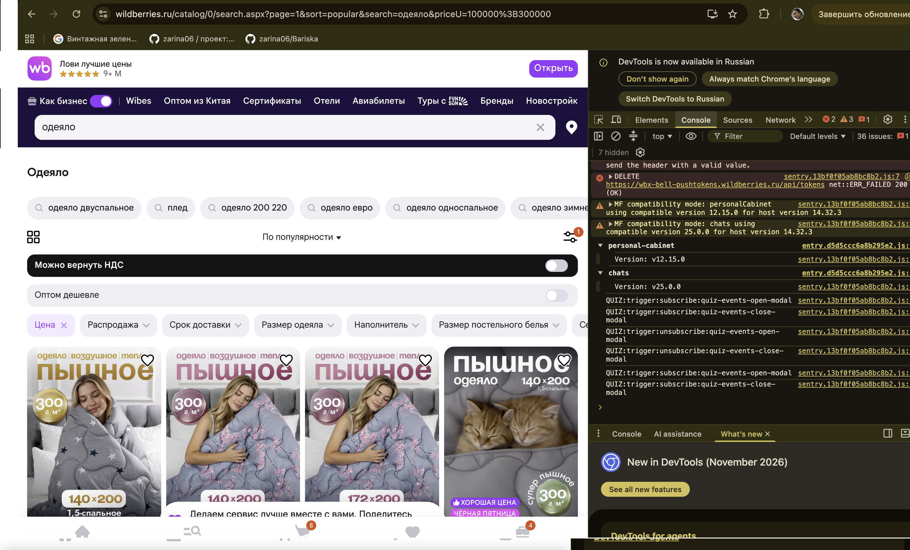

# Баг-репорты (Bug Reports): Веб-платформа Wildberries

**Инструменты локализации:** Google Chrome, Chrome DevTools (Console, Network)  
**Автор:** Зарина (Junior Manual QA)

---

### BUG-01: Блокировка запроса push-токенов политикой CORS в консоли браузера при загрузке страницы

* **Серьёзность (Severity):** Minor (Незначительный — не блокирует основной функционал, но вызывает ошибки в консоли и сбой работы push-уведомлений)
* **Приоритет (Priority):** Low (Низкий)
* **Окружение:** macOS, Google Chrome (актуальная версия)

#### Предусловие
Открыт браузер Google Chrome, включена панель разработчика (DevTools -> вкладка `Console`).

#### Шаги воспроизведения
1. Перейти на страницу маркетплейса по адресу `https://wildberries.ru`.
2. Дождаться полной загрузки страницы и выполнить поиск по каталогу.
3. Проверить логи во вкладке `Console` панели Chrome DevTools.

#### Ожидаемый результат
Страница загружается штатно, критические ошибки сетевых запросов и политики CORS в консоли браузера отсутствуют.

#### Фактический результат
Запрос `DELETE https://wildberries.ru` блокируется браузером с ошибкой политики безопасности CORS (`Access-Control-Allow-Origin`), в консоли фиксируется статус `net::ERR_FAILED 200 (OK)`.

#### Вложения (Скриншот)

Используйте код с осторожностью.
4. Нажмите зелёную кнопку «Внесите изменения...» и подтвердите сохранение.

Шаг 2. Обновите оглавление на главной странице (README.md)

1. На главной странице вашего репозитория (как на текущем скриншоте) нажмите на маленький значок карандаша в правом верхнем углу рамки README (справа от заголовка README).
2. Замените раздел ## 📂 Содержание репозитория на этот обновлённый список, чтобы все ваши работы были на виду:
markdown
## 📂 Содержание репозитория
1. **[Ecommerce_API_Tests.postman_collection.json](./Ecommerce_API_Tests.postman_collection.json)** — Коллекция запросов в Postman для проверки REST API интернет-магазина (получение данных, создание карточки товара, обработка ошибки `404 Not Found`).
2. **[Checklist_and_TestCases_WB.md](./Checklist_and_TestCases_WB.md)** — Чек-лист и подробные тест-кейсы для проверки поиска, фильтрации и адаптивной вёрстки маркетплейса Wildberries (подтверждено скриншотом [network_filter_200.png](./network_filter_200.png)).
3. **[Bug_Reports.md](./Bug_Reports.md)** — Баг-репорт по выявленному дефекту сетевого запроса (ошибка CORS в консоли Chrome DevTools) с приложенным скриншотом.

